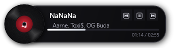

# 🎵 Vinyl Now Playing (Виджет виниловой пластинки для Windows)

Стильный плавающий виджет для Windows 10 / 11 в **глубокой темной теме** с крутящейся виниловой пластинкой, которая вылетает справа экрана **только при воспроизведении музыки** из любых источников.



---

### Особенности

1. **Крутящаяся виниловая пластинка (вынесена за пределы капсулы)**:
   - Текстура винила с дорожками и оптическими бликами выступает влево за пределы прямоугольника в прозрачное пространство.
   - В центре пластинки отображается **логотип / обложка играющего трека**.
   - Непрерывное вращение 60 FPS по часовой стрелке при воспроизведении музыки.

2. **Выезд плашки ТОЛЬКО при воспроизведении музыки**:
   - Как только музыка начинает играть (Яндекс Музыка, Spotify, YouTube/VK в браузере и др.) - плашка плавно вылетает справа экрана.
   - При паузе или остановке музыки - плашка плавно уезжает обратно за пределы экрана, а вращение останавливается.
   - Не перехватывает фокус ввода (`WS_EX_NOACTIVATE`) - не отвлекает от игр и печати.

3. **Полная поддержка Яндекс Музыки, Spotify и любых браузеров**:
   - Работает через системный Windows Media API (GSMTC) с поддержкой всех активных медиасессий.
   - Поддерживает: Яндекс Музыка (десктоп и браузер), Spotify, Chrome, Firefox, Edge, Opera, VK Музыка, Telegram, VLC, AIMP и другие.

4. **Автозагрузка с Windows и трей**:
   - Автоматически прописывается в автозапуск при первом старте (можно включить/выключить в меню трея).
   - Можно зажать ЛКМ и перетащить виджет в любое удобное место экрана (двойной клик сбрасывает в угол).
   - Значок в системном трее Windows (возле часов) с быстрым меню.

---

### Запуск

Просто запустите файл:
```
VinylNowPlaying.exe
```